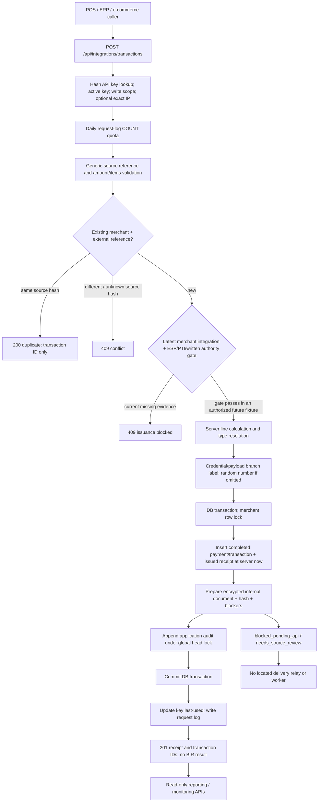
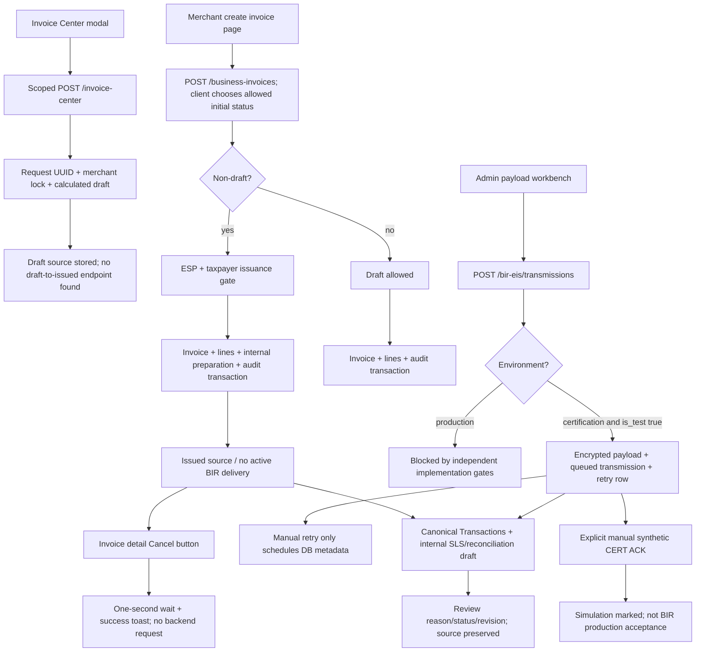
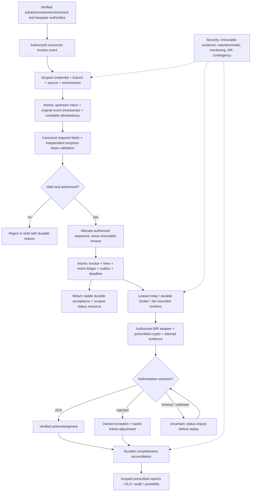

> **Approved local remediation follow-up — 2026-10-16T23:12:43+08:00.** The original read-only findings below are historical. Source code, dependencies and localhost schema were subsequently changed under the user’s “Please proceed fix all” authorization. Read [NUERS_REMEDIATION_REAUDIT_2026-10-16.md](./NUERS_REMEDIATION_REAUDIT_2026-10-16.md) and the matrix’s `current_*` columns for the current assessment. **BIR production readiness remains NOT READY.**

# NUERS current versus target flow

Audit date: **16 October 2026 (Asia/Manila)**. Compiled 2026-10-16T22:11:55+08:00.

Target: local working tree `/Users/marksioson/Desktop/NUERS`, branch `main`, HEAD `12f05be63f2134f0b96b592d713fecf31396d2f7`. This checkout has substantial pre-existing modified/untracked application files. Findings apply to the inspected working tree, **not** clean HEAD and **not** an independently inspected production deployment. Laravel lockfile: **v12.58.0**; PHP requirement `^8.2`; React/TypeScript frontend.

Method: source and migration inspection, navigation/form/route mapping, redacted local configuration inspection, existing artifact/log review and official-source browsing. **No application/security/load tests, API requests, database queries, scans, jobs, BIR calls or deployments were executed in this audit.** Existing tests are evidence of available scenarios, not freshly executed verification. Only these seven audit deliverables are added under `docs/audits/`; application/configuration/production data remain unchanged.

## Observed actual flow: merchant API

Code trace: `routes/api.php:88`; `IntegrationTransactionController::store` at `app/Http/Controllers/Api/IntegrationTransactionController.php:17-219`, authentication at222, quota at324, branch at451; `IntegrationContract::rules/calculateDocument` at12/52; `EisDocumentReadiness::prepare` at176; `BirCompliance::assertCanIssue/audit` at137/150. This is a source trace, not a newly executed invoice or live BIR call. Global approval gates currently remain blocked according to source configuration and prior local evidence.

Missing boundaries: key environment is not enforced; branch/authority lacks mandatory exact binding; original merchant event timestamp, event type and versioned source event identity are not in the contract; quota is non-atomic; concurrent duplicate insert errors are not translated to the stable winner response; no credential-authenticated status-query resource is returned.

## Observed actual flow: portal and certification paths

Code: `InvoiceCenterController.php:142-175`; `BusinessInvoiceController.php:120-292`; `invoice-detail.tsx:136-146`; `EisController.php:224-431`; `OperationsReportController.php:15-98,205-225`. The independent certification workbench accepts manually supplied synthetic payload; it is not an implemented consumer of the new normalized outbox. Source-link columns exist, but `storeTransmission` does not populate the new source-document type/id linkage from the outbox. Do not treat the two queues as one complete delivery pipeline.

## Target flow (design, not observed implementation)

## State and transition comparison

| Target state or transition | Observed implementation | Mismatch / controls |
|---|---|---|
| Draft | Persisted through two create paths | Calculations/schema differ; no complete draft editing/publish state machine demonstrated (I03-I05). |
| Draft -> Validated -> Issued | New invoice can start in a client-supplied allowed status; non-draft gate exists | No validated transition/event service enforcing all intermediate states; no authorized series allocator (I04). |
| Issued -> internal intent | Atomic in current-schema invoice/API creation | Real improvement; compatibility hasTable branch skips intent on absent schema. Deployment schema check required (Q01). |
| internal intent -> Queued -> Transmitting | Internal readiness statuses and separate certification retry rows | No relay/worker leases, durable broker handoff or drain process found (Q02/H05). |
| Transmitting -> Submitted | Metadata columns exist | No real adapter execution or preserved genuine send outcome (B01/B02). |
| Submitted -> Acknowledged | Manual certification simulation; strong verification rule in Transactions | No authentic response implementation; Live Monitoring/Enterprise readers use weaker criteria (B03/P02). |
| Submitted -> Rejected | Some stored failure/rejection display and review | No verified provider rejection processor or lawful correction state handoff (B03/I05). |
| Timeout -> Uncertain -> inquiry -> safe retry | No implemented inquiry state/worker | Existing bounded administrative retry is insufficient (B04). |
| Accepted original -> correction/void | Original/credit/debit reference check exists | Cancellation UI claims success without persistence; original handoff not supplied by correction navigation (I05). |
| Offline/manual -> recovery reconciliation | Incident restoration fields only | No upstream encrypted persistent offline queue or manual register/linkage (M04/M10/C03). |
| Complete source -> reconciled SLS | Canonical internal draft exists | No prescribed official SLS output/version, automated durable completeness job or complete tenant migration workflow (R01/S01/D01). |

## Actual status semantics

Payment `completed`, receipt `issued`, internal copy `blocked_pending_api`, local payload `valid`, certification `acknowledged` and production `acknowledged` represent distinct claims. Current code partly separates them; its readers do not enforce one common contract. Any diagram showing full working BIR delivery today would overstate the evidence. No current path was found that completes the requested target from an actual merchant event through authentic BIR acknowledgment and reconciliation.

## Approved remediation follow-up

Current local flow is authenticated/versioned source event → exact environment/branch/permit gate → calculated source + locked series + immutable financial records + encrypted preparation + blocked durable job in one transaction → stable accepted resource/status. The default provider cannot transmit. A supplied verified provider follows lease/intent/attempt → send or inquiry → authentic terminal evidence / uncertain / bounded retry / DLQ. This is not an official BIR wire flow. Offline SDK adoption/manual authorization remain pending.
