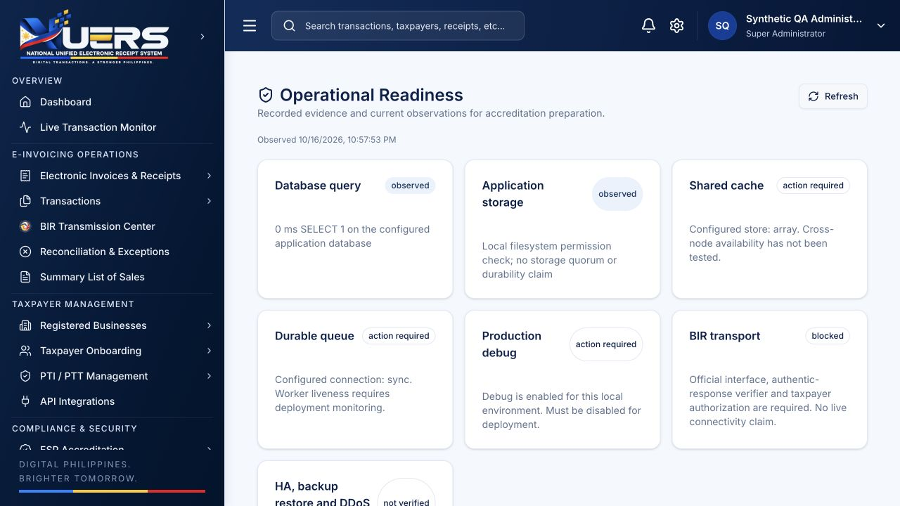

# NUERS local remediation and re-audit

**Verdict: NOT READY for BIR production or accreditation sign-off.** The exploitable local account/data boundaries have been repaired and the internal workflow foundation has been strengthened. External BIR interoperability, actual taxpayer/accreditation evidence and independent operational assurance have not been established. This is a local engineering remediation, not a legal certification or production deployment.

Completed assessment: **2026-10-16T23:45:29+08:00**. Target: `/Users/marksioson/Desktop/NUERS`, localhost:8001, MySQL 127.0.0.1:3307/NUERS. Original working-tree baseline was dirty `main` at `12f05be63f2134f0b96b592d713fecf31396d2f7`; pre-existing work was preserved. No live Plesk/nuers.net files or financial data were changed. The original read-only audit remains historical; the user subsequently authorized fixing its findings.

## Verified results

- **143 PHP tests / 1568 assertions passed**, in isolated SQLite fixtures. The additional Node crypto suite passed **2 tests**. These are functional/security regressions, not capacity or independent penetration testing.
- A bounded native **MySQL 8.4.11** regression in a separate synthetic database used two competing controller-level source submissions: one returned 201, the other 200 with the same saved resource; exactly one event/sequence reservation committed. A forced outbox failure rolled the next reservation/ledger/inbox back. This used fixture-only authority, not real permission, and was not a capacity/load test. A separate native MySQL persistence regression confirmed that identical numbers from two suppliers preserve two original source rows, repeated delivery preserves the first row ID, and unreviewed VAT remains excluded from credit totals.
- Laravel and static TypeScript/Vite builds passed. Bundles still have a large-chunk warning; the referenced existing image URLs remain runtime assets and were visible in browser QA.
- Composer lockfile and npm lockfile re-audits report **zero known advisories** in their current feeds. Laravel is now **12.70.0**; dependencies were updated within existing constraints, without install scripts or production deployment. This says nothing about unlisted vulnerabilities, OS/runtime/container packages or independent assessment results.
- Local database: **87 tables, zero pending migrations**. Backup preceded migrations. Every existing table’s original columns matched before/after the workflow and expense provenance migrations; the prior security migration intentionally revoked legacy plaintext sessions.
- Original financial population remains **13 transactions / PHP 750,400.00**. Canonical source population remains **16 documents**. All **48 preserved encrypted preparation versions** decrypt and match their hashes; audit-chain integrity passes. **16 current preparations** have blocked durable delivery jobs. No BIR request or external webhook was sent.
- No plaintext human bearer tokens remain. Role changes revoke existing sessions atomically, enrolled optional MFA is enforced, and encoded URL aliases cannot bypass privileged role checks. **Six existing API keys without expiry require replacement**; absent expiry now fails authentication. No replacement secret, real branch, permission, certificate or approved series was fabricated.
- Browser QA used a separate synthetic SQLite database at localhost:8002. Login redirected a privileged fixture to MFA; the existing fixture authenticator code unlocked the admin workspace. The operational page displayed measured DB/filesystem observations, local configuration warnings and blocked/unverified external controls. It did not use or alter actual NUERS financial data.

Current matrix totals (use `current_status`, not historical `status`): **40 PARTIAL, 6 PASS, 8 NOT VERIFIED**. PASS applies only to the named local regression/control scope; it is not a production conformance statement.

## Finding disposition and current source evidence

| Finding | Disposition | Remediation / remaining limitation | Current evidence |
|---|---|---|---|
| F01 | Closed locally | Unauthenticated RDO credential/role overwrite removed; RDO office writes require explicit administrative access and cannot accept passwords. | app/Http/Controllers/Api/RdoController.php:24; app/Http/Middleware/ApiBoundary.php:12; tests/Feature/SecurityRemediationTest.php:14 |
| F02 | Closed locally | Legacy financial and expense aliases require authentication; default-merchant fallbacks and GET-time expense imports removed. Static protected API aliases have a regression inventory. | app/Http/Middleware/ApiBoundary.php:12; app/Http/Controllers/Api/MerchantExpenseController.php:55; tests/Feature/SecurityRemediationTest.php:14 |
| F03 | Closed locally | Organization/email/display-TIN association fallbacks removed; citizen taxpayer access requires a reviewed identity plus active linked account. Identity approvals are serialized. | app/Services/ApiAccess.php:11; app/Http/Controllers/Api/DocumentGovernanceController.php:16; tests/Feature/SecurityRemediationTest.php:14 |
| F04 | Contained / external authority pending | Production intake rejects sandbox keys, wrong branches, expired/unbounded keys and inactive merchants. Maintained PTI must match taxpayer, production environment and exact branch. | app/Http/Controllers/Api/IntegrationTransactionController.php:52; app/Services/BirCompliance.php:158 |
| F05 | Partial | Encrypted durable delivery leases/intent/attempts/inquiry/backoff/DLQ implemented. Built-in provider is blocked; the official adapter and real interoperability remain absent. | app/Services/EisDelivery.php:12; app/Services/Eis/BlockedProvider.php:7 |
| F06 | Partial | Versioned source events, original time, namespace uniqueness, stable accepted resource/status and locked series implemented. Actual connector/native concurrency and timing measurements remain pending. | app/Services/IntegrationContract.php:12; app/Http/Controllers/Api/IntegrationTransactionController.php:52; app/Services/InvoiceSequence.php:10 |
| F07 | Partial | Integer arithmetic, independent VAT price basis, complete buckets, source reconciliation and draft publication improved. Three imported invoice bases remain inconsistent and official tax/schema mapping is unavailable. | app/Services/IntegrationContract.php:12; app/Http/Controllers/Api/MerchantTaxCenterController.php:143; app/Http/Controllers/Api/DocumentGovernanceController.php:16 |
| F08 | Closed core session gap; custody pending | Human bearer tokens are hashed, expire, are device-bound and revoked on replacement/logout. Privileged access requires encrypted TOTP/recovery with replay rejection. Real users must enroll; vault/rotation custody remains external. | app/Services/ApiAccess.php:11; app/Http/Controllers/Api/MfaController.php:14; tests/Feature/SecurityRemediationTest.php:14 |
| F09 | Partial | Shared atomic credential quota counters, request/identifier bounds and deployment/edge/worker references added. No measured capacity, HA or real DDoS protection claim. | app/Services/AtomicQuota.php:8; app/Http/Controllers/Api/OperationalEvidenceController.php:11; routes/console.php:76 |
| F10 | Closed targeted UI assurance gaps | Cancellation saves a real pending review, retries use a stable request ID and independent decisions preserve originals. Targeted placeholder operations pages show measured checks and explicit unknowns; seeded health/AI metrics are no longer treated as proof. Legacy tax analytics now uses canonical source totals with unknown values marked unverified. | app/Http/Controllers/Api/DocumentGovernanceController.php:16; app/Http/Controllers/Api/OperationalEvidenceController.php:11 |
| F11 | Partial | Dashboard/monitor/transaction acceptance readers now require a common strong proof predicate and production separation. Real adapter-to-projection and authoritative provider semantics remain unverified. | app/Services/SubmissionEvidence.php:9; app/Services/EisDelivery.php:12 |
| F12 | Partial | Legal holds, independent written releases, scoped streaming source/metadata/audit exports, hashes/manifests and optional signed checkpoints added. Final retention/disposition, immutable offsite custody and migration recovery tests remain pending. | app/Http/Controllers/Api/DocumentGovernanceController.php:107; app/Services/TenantPortability.php:9; routes/console.php:76 |
| F13 | Partial | Case owner/priority/due/closure evidence, independent closure, revision guards, audit events and durable internal reminders implemented. Complete continuous operational routing/escalation validation remains pending. | app/Http/Controllers/Api/OperationsReportController.php:209; routes/console.php:76 |
| F14 | Closed identified local gap | Generic SQL filter/order identifiers are schema-allowlisted and result sizes bounded. No confirmed injection was found; negative identifier tests pass. Production DB grants still need inspection. | app/Http/Controllers/Api/TableController.php:296; tests/Feature/SecurityRemediationTest.php:14 |
| F15 | Contained / assessment pending | Raster uploads are decoded/re-encoded to generated PNG names; client suffixes/metadata/trailing payloads are discarded. CSP/headers and a disabled signed/HTTPS/DNS-pinned/no-redirect sender were added. Independent XSS/egress/VAPT verification remains pending. | app/Services/SafeImage.php:9; app/Http/Middleware/SecurityHeaders.php:8; app/Services/SignedWebhook.php:10 |
| F16 | Partial | Expense reads do not mutate; supplier-document IDs replace number/TIN collision keys without overwriting historical rows. Reviews fingerprint original header and lines; changed/corrected sources and duplicate/unreviewed credits are held. The expense form uses the secured source-review contract, and the credit summary excludes unsupported claims. Actual tax evidence and original imported corrections remain required. | app/Http/Controllers/Api/MerchantExpenseController.php:55; app/Services/ExpenseCreditEvidence.php:7; app/Http/Controllers/Api/MerchantTaxCenterController.php:143 |

## Behavior changes that integrations and operators must account for

1. Existing users must sign in again after the plaintext-token revocation. Admin/super-admin/BIR/RDO access requires authenticator enrollment or verification; verification expires after 15 minutes and sessions after 120 minutes. Recovery codes work once. Browser device IDs are not hardware attestation.
2. Ownership comes from explicit account IDs and independently reviewed citizen identity, never email/name/profile TIN. Citizen signup creates a pending account; the citizen UI submits evidence for review and gets a barcode only from the server-verified identity. Suspension blocks mutations while preserving authorized read/export access after reauthentication.
3. Merchant ingestion now requires the versioned internal source-event contract and a real exact branch. A sandbox key cannot create production financial records. Existing keys without expiry must be replaced. No available permit/series evidence means production issuance stays blocked.
4. Drafts remain possible. Publication validates stored amounts, reserves the configured series in its transaction and preserves lifecycle/outbox evidence. Issued originals are immutable. Cancellation is a review request; resolution requires an independently reviewed linked issued corrective document. Arbitrary upstream credit/debit imports and BIR-specific cancellation semantics still need the verified contract.
5. An API 201 means durable local commit. A retry returns the original accepted resource/status URL. Neither means BIR acceptance. Source timestamps are preserved; source identity reuse with changed content is rejected.
6. Outbound provider transport defaults to `BlockedProvider`; webhook delivery also defaults to disabled. Saving credentials, a URL or a database status cannot implement an official protocol or establish authorized network delivery.
7. Tax summaries are internal drafts from source-reconciled canonical documents. Missing/historically inconsistent documents and unreviewed input VAT do not become approved by recalculating stored source amounts. Supplier expense claims require an original source ID and independent review; recognized credits bind the original header and lines and are held if that source changes or receives an issued corrective document. Historical expense rows remain untouched for review.

See [merchant contract and operational commands](../integrations/merchant-ingestion-1.md). The encrypted offline SDK is an optional connector component; it is not deployed to POS/ERP devices and does not authorize offline legal issuance. A real approved manual/contingency issuance and recovery procedure, actual connector adoption and browser restart/reconnect testing remain necessary.

## External and deployment blockers retained

- Obtain the controlled official BIR interface/schema/auth/signing/encryption/response/inquiry package and authorized sandbox access. Implement and review its adapter and shared official projections; run end-to-end supervised tests before any activation. Current transport/interface/authentic-response flags all remain false.
- Obtain real solution/version/configuration accreditation, maintained exact-branch PTI/PTT, written taxpayer authorization, current certificates, coverage/effective dates and authorized series evidence. User confirmed these are not yet available. No control has been marked approved using synthetic or guessed evidence.
- All **16** imported sources still lack verified historical branch snapshots. **Three** invoice records still need original financial basis or a lawful correction. Their original amounts and dates were preserved. Missing evidence is an explicit hold, not a default `00000` branch or an artificial accepted result.
- The local development environment intentionally remains HTTP/debug with a local cache and synchronous general queue; `security:deployment-check` currently fails the production gate. Reviewed deployment references are in `deployment/security/`. Actual production needs TLS, shared cache/queue workers, origin/WAF configuration, least-privilege grants, independent secret/checkpoint custody and artifact/change approval. These were not configured on Plesk by this task.
- Infrastructure topology/quorum/fencing, offsite immutable backup restore and measured RTO/RPO, 1M/hour, 2K-TPS burst, soak, failure and DDoS efficacy remain **NOT VERIFIED**. Global audit/merchant serialization and some PHP report scans remain capacity risks. No disruptive load, failover, DDoS or external security campaign was executed.
- Independent VAPT/SAST/EO119/ISO/SOC and required documentary/service/financial assessments cannot be supplied by application code or a dependency scan. No accreditation or external assessment result is claimed.
- Final statutory retention/disposition rules, immutable independent custody, actual recipient escalation/SLAs and cross-system restore/export completion still require operational/domain evidence and controlled validation.

## Verification and evidence custody

Private operational evidence (not committed): `.local/remediation-20261016/native-mysql-regression.json`, `native-mysql-regression.php`, `tests.log`, `offline-tests.log`, `build-all.log`, `composer-audit.before.json`, `composer-audit.json`, `npm-audit.before.json`, `npm-audit.json`, `reaudit-local.json`, `http-headers.txt`, `native-expense-regression.json`; migration preservation reports in `.local/eis-readiness-fix-20261016/`.

The latest pre-provenance SQL backup is `.local/backups/NUERS_before_expense_source_provenance_20261016_234429.sql` (workflow backup: `.local/backups/NUERS_before_durable_workflow_20261016_225114.sql`); earlier security/session backup is `.local/backups/NUERS_before_security_remediation_20261016_222926.sql`. These are private backups, not a completed independent recovery drill. Application encryption keys were not regenerated.

The component inventory and source/test hashes are recorded in [NUERS_COMPONENT_INVENTORY.json](./NUERS_COMPONENT_INVENTORY.json) and [NUERS_REMEDIATION_EVIDENCE.json](./NUERS_REMEDIATION_EVIDENCE.json). They bind this local inspection; they are not signed regulatory attestations. TOTP implementation is checked against the public [RFC 6238](https://www.rfc-editor.org/rfc/rfc6238) vectors and the [RFC 4226](https://www.rfc-editor.org/rfc/rfc4226) HOTP primitive.

## Merchant dashboard follow-up — 17 October 2026

The merchant overview now follows the supplied design with a tenant-scoped read-only projection, separate payment/sales totals and evidence-based BIR statuses. Current dashboard source hashes, verification and deliberate compliance-related design changes are recorded in [merchant-dashboard-alignment.json](../design/merchant-dashboard-alignment.json). The dated complete-project audit above and its original hash manifest remain the earlier assessment snapshot.
