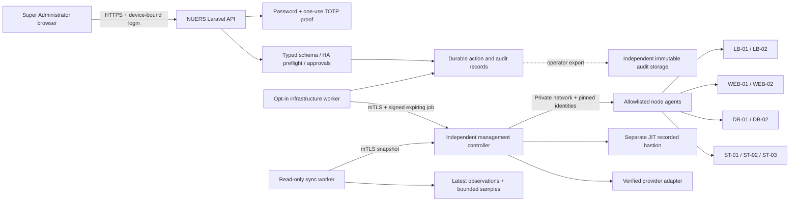

# NUERS Server Management — architecture

Version 1.0.0 · 20 October 2026 · implementation and integration contract

## Application boundary

The page is available at `/super-admin/server-management`. It uses the existing NUERS header, sidebar, logo and footer. The new APIs are restricted to the existing `super_admin` role. This release provides inventory, secure request orchestration, a controller client and isolated tests. It does not provision an independent controller, install host agents or establish provider access.

The nine-node inventory contains planned hardware only. Live IPs, OS, current database role, uptime, resource usage and health remain empty until a pinned controller snapshot is accepted. The owner previously described Dataplugs, Contabo and AWS Singapore/Hong Kong as planned providers/locations; no active placement is inferred.

## Persistence and failure domains

- `infra_nodes`: planned enrollment, verified fingerprint, latest observation, maintenance window and optimistic revision.
- `infra_samples`: maximum 672 observations per node, sampled no more frequently than 15 minutes. This is a bounded UI cache, not a high-frequency monitoring database. Up to 100 inventory entries are permitted.
- `infra_actions`: immutable request parameters, correlation/job UUID, idempotency hash, policy/preflight snapshot and mutable state projection.
- `infra_approvals`: unique reviewer/action pairs, session-bound independent decisions.
- `infra_proofs`: expiring one-use step-up records, bound to current login and password hash; no password or OTP is stored.
- `infra_events` / `infra_state`: serialized hash-chain audit and concurrency lock. Event writes are append-only through application code; privileged DB tampering requires external WORM/checkpoint detection.

These tables use the existing application database in this release. Consequently, the application UI/request store does **not** yet survive loss of that database. The external management controller, agent queue, bastion, audit storage and monitoring store must be deployed independently before production control is enabled. Moving the request store into an independently operated management service is a remaining production architecture task, not a property established by this migration.

## Action lifecycle

`preflight → blocked | awaiting_approval | scheduled → running → validating → succeeded | failed | rolled_back | uncertain`

`cancelled`, `rejected` and `expired` are terminal non-execution outcomes. The workflow records requested, dispatch, validation and outcome events. Critical actions require one independent reviewer; production restores require two. Requests expire after 15 minutes. A controller must refuse a job not begun within its signed start deadline (maximum 60 seconds).

Every dispatch revalidates requester/reviewer sessions, current identities, environment, capability allowlists, telemetry, HA peers and maintenance/backup prerequisites. The singleton state row serializes transitions; active or uncertain jobs lock the entire HA group. Network calls occur outside the database transaction. A timeout never causes a blind resubmission: reconciliation queries the original job UUID. Missing or failed postchecks retain the group lock.

The remote controller must atomically reserve that same HA group, repeat safety checks at execution time, deduplicate job UUIDs, and enforce each typed runbook. This client cannot replace server-side enforcement on the controller.

## Telemetry and display

- Observations expire after 120 seconds; a replayed or older observation cannot advance freshness.
- Revoking/changing a pin immediately invalidates that node's current observation.
- Offline means a fresh explicit unreachable observation. Missing/stale telemetry is shown separately and does not become “offline” or 0% usage.
- CPU/RAM averages include only fresh reachable nodes reporting that metric; denominators are visible.
- Storage totals represent reported host filesystem bytes. They do not establish Ceph logical usable capacity, unique data size or independent backup capacity.
- API timestamps are stored in UTC and the page displays Asia/Manila (PHT).

## HTTP API

All endpoints are under `/api/admin/infrastructure`; bearer/device headers and privileged login MFA apply. Responses are private/no-store.

| Method / path | Behavior |
|---|---|
| GET `/servers` | Inventory, six KPI aggregates, observed status, controller readiness and action catalog |
| GET `/servers/{uuid}?range=1h\|6h\|24h\|7d` | Node detail, bounded samples and node audit records |
| POST `/servers` | Request enrollment; does not trust an agent or contact an IP |
| POST `/servers/{uuid}/maintenance` | Record one node's UTC maintenance window with revision check |
| POST `/step-up` | Current password + enrolled authenticator → one-use proof (5-minute expiry) |
| POST `/preflight` | Evaluate a typed request without executing it |
| POST `/actions` | Create an idempotent controlled request |
| POST `/actions/{uuid}/review` | Approve/reject independently, or requester cancellation |
| GET `/actions` | Paginated action history, optional node/state filters |
| GET `/events` | Paginated structured infrastructure audit |
| GET `/export` | Audited, spreadsheet-formula-safe inventory CSV |

No endpoint accepts an arbitrary shell command, management URL, filesystem path, credential or raw log stream.
